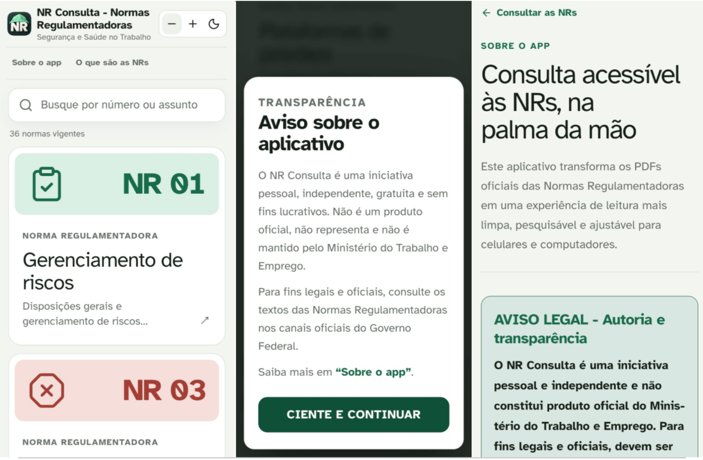
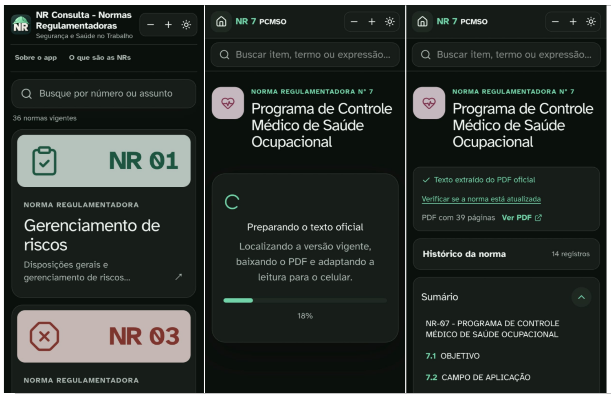
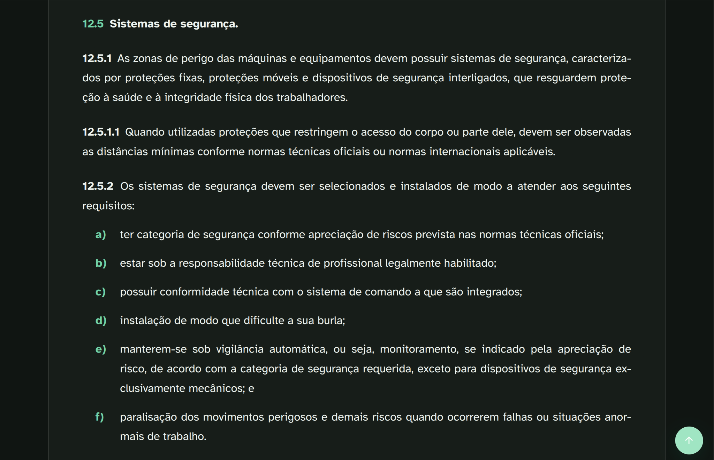

# NR Consulta — Normas Regulamentadoras

Aplicativo gratuito para facilitar a consulta e a leitura das **Normas Regulamentadoras (NRs) brasileiras** de Segurança e Saúde no Trabalho.

O **NR Consulta** oferece uma forma simples, rápida e agradável de acessar as NRs em dispositivos Android, com interface otimizada para leitura e pesquisa.

> **Aplicativo independente e não oficial.** O NR Consulta não representa, não é afiliado e não é mantido pelo Ministério do Trabalho e Emprego ou por qualquer outro órgão governamental. Os textos das Normas Regulamentadoras são obtidos das publicações oficiais do Ministério do Trabalho e Emprego.

## 📱 Funcionalidades

- download dos PDFs oficiais das Normas Regulamentadoras;
- conversão, leitura e pesquisa executadas localmente no dispositivo;
- armazenamento local das normas já abertas para consulta offline;
- verificação automática de atualização após 90 dias;
- busca de NRs por número ou assunto;
- pesquisa de palavras, itens e expressões dentro de cada norma;
- sumário clicável e navegação facilitada entre os itens;
- tabelas, imagens e gráficos preservados e adaptados à tela do celular;
- ampliação de imagens com gesto de pinça;
- modo claro e escuro;
- controle persistente do tamanho do texto;
- exibição das ementas e dos graus de infração da NR-28 quando aplicáveis.

## 🖼️ Capturas de tela

### Consulta das Normas Regulamentadoras

### Download e processamento do PDF oficial

### Leitura otimizada

## ⬇️ Download

Baixe a versão mais recente do APK Android na página de [Releases](https://github.com/sandersom-favero/nr-consulta/releases/latest).

Para instalar, talvez seja necessário autorizar temporariamente a instalação de aplicativos de fontes externas nas configurações do Android.

## 🔒 Privacidade

O NR Consulta não coleta, armazena nem compartilha dados pessoais dos usuários. As funcionalidades de leitura e pesquisa são executadas localmente no dispositivo.

Leia a [Política de Privacidade](https://sandersom-favero.github.io/nr-consulta/privacy-policy.html).

## 🌐 Fonte oficial

Os textos das Normas Regulamentadoras são obtidos das versões oficiais disponibilizadas pelo **Ministério do Trabalho e Emprego (MTE)**.

Para fins oficiais ou antes de tomar decisões com base no conteúdo apresentado, consulte a versão vigente no [Portal do MTE](https://www.gov.br/trabalho-e-emprego/pt-br/assuntos/inspecao-do-trabalho/seguranca-e-saude-no-trabalho/ctpp-nrs/normas-regulamentadoras-nrs).

## 📦 Distribuição

Este repositório é destinado à distribuição do APK, à publicação da política de privacidade e à apresentação do aplicativo. O código-fonte do NR Consulta não é distribuído publicamente.

O aplicativo é e sempre será disponibilizado gratuitamente para instalação e uso. Componentes de terceiros incorporados ao aplicativo permanecem sujeitos às respectivas licenças.

Copyright © 2026 Sandersom Fávero. Todos os direitos reservados sobre o código e os elementos próprios do NR Consulta.

## 💬 Suporte

Para relatar problemas ou enviar sugestões, abra uma [Issue](https://github.com/sandersom-favero/nr-consulta/issues).
